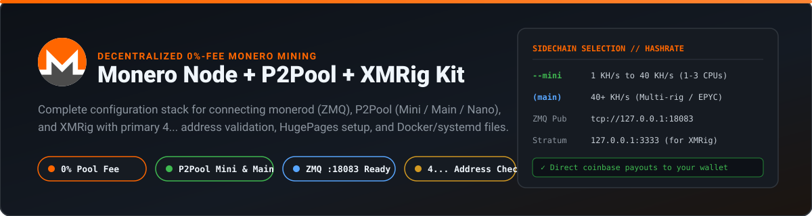
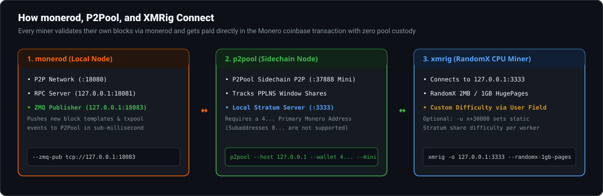

<p align="center">
  
</p>

# Monero Node + P2Pool + XMRig Setup Kit

Ready-to-use configurations, Docker Compose files, `systemd` services, and a command generator for decentralized Monero mining with **`monerod`** (ZMQ), **`p2pool`** (Mini, Main, or Nano sidechain), and **`xmrig`**.

---

## Why Mine on P2Pool Instead of a Centralized Pool?

- **0% pool fee and no custodial balance:** Payouts are written directly into the Monero coinbase transaction whenever a block is found. No central pool operator ever holds your XMR.
- **Low minimum payout (~0.0003 XMR):** You get paid as soon as P2Pool finds a block while you have an active share in the PPLNS window.
- **You validate your own blocks:** Every P2Pool miner runs their own `monerod` node, strengthening Monero network consensus.

For background guides and live earnings estimates:
- [Monero P2Pool Mining Guide](https://monkstash.com/monero-p2pool)
- [How to Mine Monero](https://monkstash.com/mine-monero)
- [Monero Mining Calculator (Live Network Difficulty)](https://monkstash.com/tools/monero-mining-calculator)

---

## Architecture: How `monerod`, `p2pool`, and `xmrig` Connect

<p align="center">
  
</p>

### Critical Requirement: Use a `4...` Primary Address (Not an `8...` Subaddress)

P2Pool pays miners directly inside the Monero block reward (coinbase) transaction. Because subaddresses use per-transaction tweak keys that cannot be verified across a decentralized sidechain without exposing your private view key, **P2Pool requires a 95-character Mainnet Primary Address starting with `4...`**.

If you need a new Monero wallet with a `4...` primary address, you can create one in your browser at [MonkStash](https://monkstash.com/create-monero-wallet).

---

## Choosing Between P2Pool Mini, Main, and Nano

| Sidechain | Flag | P2P Port | Recommended Hashrate | Target Share Time | Best For |
| :--- | :--- | :---: | :--- | :--- | :--- |
| **P2Pool Mini** *(Recommended)* | `--mini` | `37888` | **1 KH/s to 40 KH/s** | 10 seconds | 1 to 3 desktop CPUs (Ryzen 5/7/9, Apple Silicon, Intel i5/i7/i9) |
| **P2Pool Main** | *(none)* | `37889` | **40+ KH/s** | 10 seconds | Multiple multi-core rigs, Threadripper, or EPYC servers |
| **P2Pool Nano** | `--nano` | `37890` | **< 2 KH/s** | 30 seconds | Low-power mini-PCs, older laptops, or single-board computers |

---

## Generate Your Exact Commands & Configs

Run [`scripts/generate-config.mjs`](scripts/generate-config.mjs) with your `4...` primary address to validate the address format and print the exact commands for your setup:

```bash
node scripts/generate-config.mjs \
  --address "48VWHdLTEpE5dqa5VpAy5xgQWBHZARiGmEmojNLqD4ef1FAzkPxCe9JXUYwCShRR5XNMGnyusrnkmMWr2HMdfDRx2vsrG7c" \
  --chain mini \
  --worker rig1
```

---

## Option 1: Docker Compose (`monerod` + `p2pool`)

1. Generate or create `.env` in this folder:
   ```ini
   MONERO_PRIMARY_ADDRESS=48VWHdLTEpE5dqa5VpAy5xgQWBHZARiGmEmojNLqD4ef1FAzkPxCe9JXUYwCShRR5XNMGnyusrnkmMWr2HMdfDRx2vsrG7c
   P2POOL_CHAIN_FLAG=--mini
   STRATUM_BIND_IP=127.0.0.1
   ```
2. Launch `monerod` (pruned with ZMQ on `18083`) and `p2pool`:
   ```bash
   docker compose up -d
   ```
3. Point `xmrig` on the host (using [`config/xmrig-config.json`](config/xmrig-config.json)) to `127.0.0.1:3333`:
   ```bash
   sudo xmrig -c config/xmrig-config.json
   ```
   *(Running `xmrig` directly on the host with `sudo` or Administrator privileges allows it to allocate 2MB/1GB HugePages and apply RandomX MSR register optimizations.)*

---

## Option 2: Bare-Metal Linux (`systemd`)

1. Copy [`config/monerod-p2pool.conf`](config/monerod-p2pool.conf) to `/etc/monero/monerod.conf` (ensuring `zmq-pub=tcp://127.0.0.1:18083` is present) and restart `monerod`.
2. Edit [`systemd/p2pool.service`](systemd/p2pool.service) with your `4...` primary wallet address, copy it to `/etc/systemd/system/p2pool.service`, and start it:
   ```bash
   sudo systemctl daemon-reload
   sudo systemctl enable --now p2pool
   ```
3. Enable Linux HugePages for XMRig:
   ```bash
   sudo sysctl -w vm.nr_hugepages=3072
   ```

---

## License

Released under the [MIT License](LICENSE).
